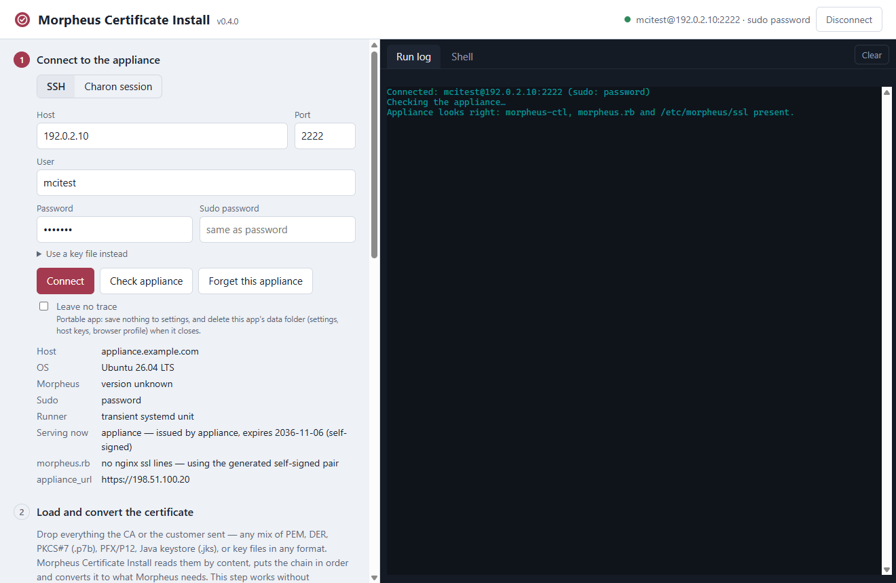
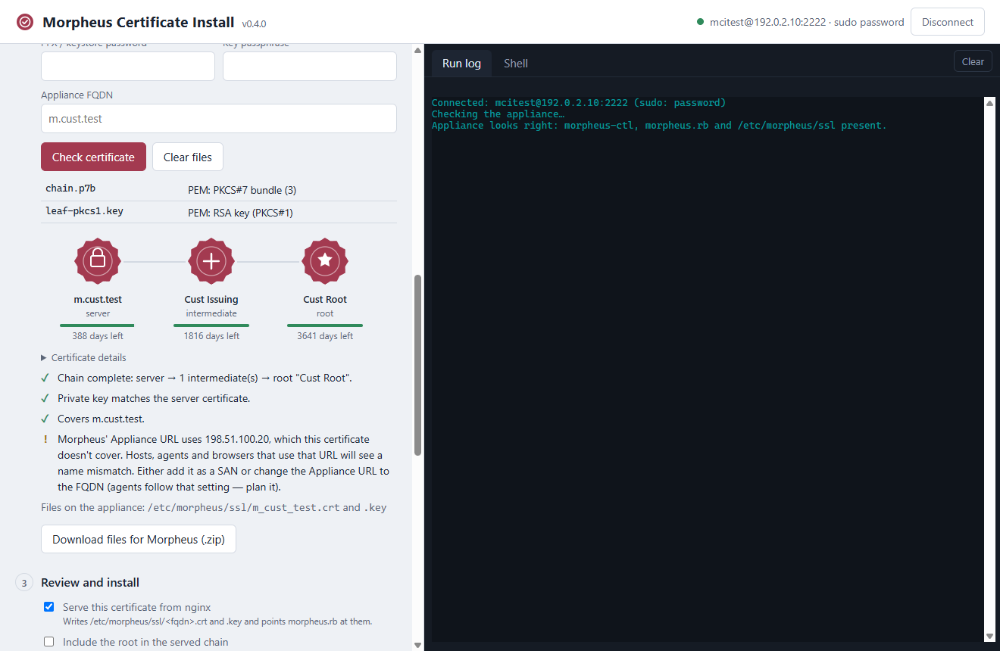
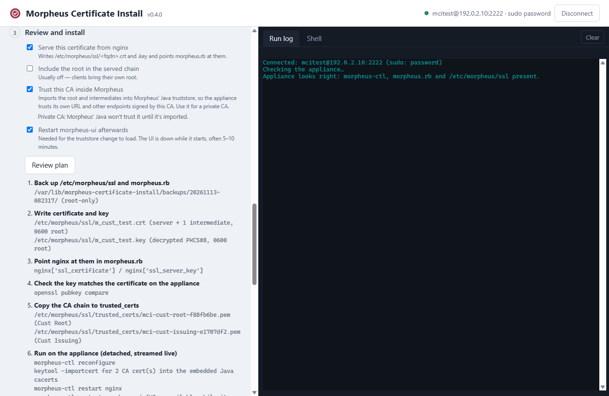
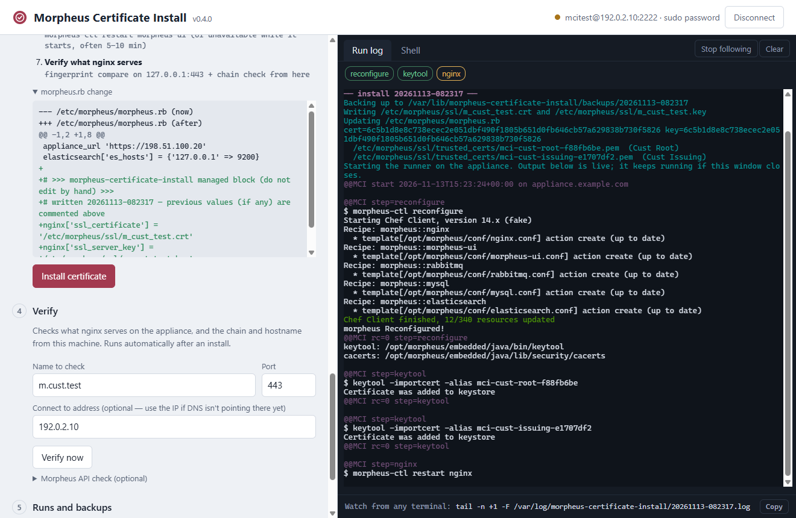
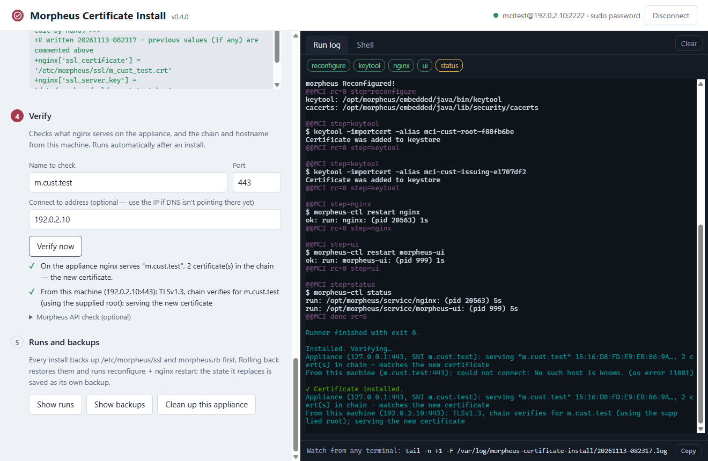
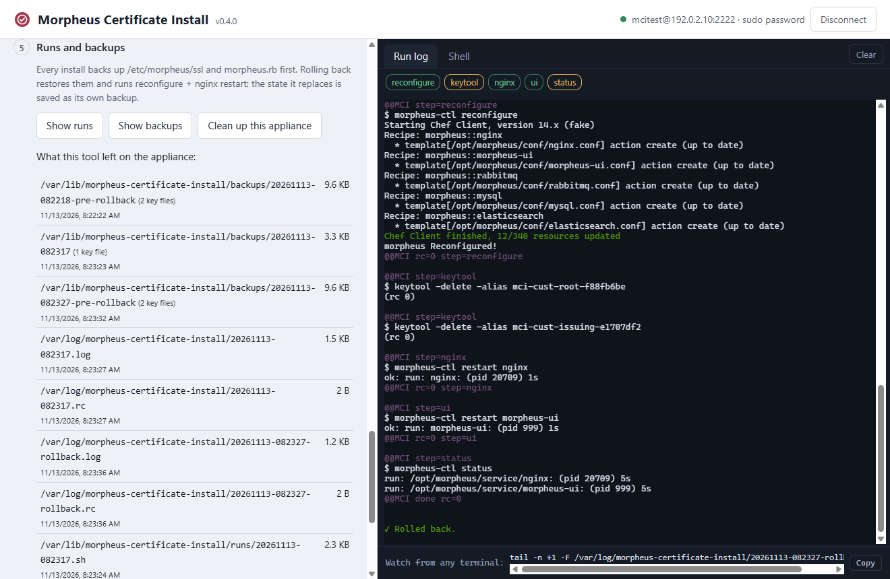

# Morpheus Certificate Install

*morpheus-certificate-install 0.4.0*

Morpheus Certificate Install takes whatever certificate files a CA or a customer sends you and turns them into the files an HPE Morpheus appliance needs. It can then install them on the appliance over SSH: it takes a backup first, shows `morpheus-ctl reconfigure` live, checks what nginx actually serves, and rolls back with one click.



## Download

Get the latest release from this repository's **Releases** page. Each release lists a `SHA256SUMS` file for checking the downloads.

| Platform | File | Notes |
|---|---|---|
| Windows x64 | `…-windows-portable.zip` | **Portable:** unzip anywhere and run `morpheus-certificate-install.exe`. Nothing is installed. |
| Windows x64 | `…_x64-setup.exe` | Installer for the current user. |
| Linux x64 | `…-linux-portable-x64.tar.gz` | Portable, like the Windows zip. Needs webkit2gtk 4.1 on the system. |
| Linux x64 | `.deb`, `.rpm`, `.AppImage` | Debian/Ubuntu, Fedora/RHEL, or any distribution. |
| macOS, Apple Silicon (M1 and later) | `…_macos-arm64.dmg` | Drag the app to Applications. **Not yet tested on a Mac.** See [macOS](#macos). |
| macOS, Intel | `…_macos-x64.dmg` | The same, for Intel Macs. |
| Windows / Linux | `morpheus-certificate-install-cli-…` | The command-line converter on its own. |
| macOS | `morpheus-certificate-install-cli-macos-arm64.tar.gz`, `…-x64.tar.gz` | The command-line converter, per chip. |

**Windows SmartScreen will warn you** the first time you run the app or the installer, because the binaries aren't code-signed. Check the file against `SHA256SUMS`, then choose **More info → Run anyway**:

```powershell
Get-FileHash .\morpheus-certificate-install-windows-portable.zip -Algorithm SHA256
```

### Portable use

The portable zip and tar.gz hold the app, the CLI and an empty `portable.flag`. While that file sits beside the app, everything it keeps lives in a `data\` folder next to it, and nothing goes into your profile. That covers the settings, the trusted host keys and the browser profile of the window.

Tick **Leave no trace** on the Connect step to save no settings at all and delete `data\` when the window closes. If a file in it is still locked at that point, the next start deletes it and tells you.

Without `portable.flag` (the installer, deb, rpm and AppImage), the app keeps the same files in `%APPDATA%\morpheus-certificate-install\` on Windows, or `~/.config/morpheus-certificate-install/` on Linux.

Portable mode and **Leave no trace** are for Windows and Linux only. The macOS app has neither (see below).

### macOS

**Not yet tested on a Mac. The macOS builds are compiled and packaged by CI, but nobody has run them yet. Reports are welcome:** open an issue, saying what worked and what didn't.

- **Which download:** an Apple Silicon Mac (M1, M2, M3, M4…) takes `…_macos-arm64.dmg`; an Intel Mac takes `…_macos-x64.dmg`. You can check in the Apple menu → **About This Mac**, where **Chip** means Apple Silicon and **Processor** means Intel.
- **First launch:** the app isn't signed or notarized, so Gatekeeper refuses to open it with a double-click. Copy it to **Applications**, then either:
  - **right-click (or Control-click) the app → Open**, and confirm **Open** in the dialog. This is needed once only. On macOS 15 and later, if there's no Open button, open **System Settings → Privacy & Security** and click **Open Anyway** next to the app's name; or
  - remove the quarantine flag in Terminal:

    ```bash
    xattr -dr com.apple.quarantine "/Applications/Morpheus Certificate Install.app"
    ```

  Check the .dmg against `SHA256SUMS` first: `shasum -a 256 ~/Downloads/morpheus-certificate-install_*_macos-*.dmg`.
- **The CLI:** `tar -xzf morpheus-certificate-install-cli-macos-arm64.tar.gz`, then `xattr -d com.apple.quarantine morpheus-certificate-install-cli` if the file was downloaded through a browser.
- **Data:** settings and trusted host keys go in `~/Library/Application Support/morpheus-certificate-install/`. There's no portable mode and no **Leave no trace**. **Forget this appliance** removes an appliance from that folder; delete the folder to remove everything.
- **Charon:** found in `~/Library/Application Support/charon` by default.

### Supported platforms

- **Windows 10/11 x64 and Linux x64:** tested.
- **macOS 11 and later (Apple Silicon and Intel):** release builds exist, but they aren't tested yet (see above).

## Quick start: convert only

You don't need an appliance for this. Open the app, drop the files the CA sent into step 2 (**Load and convert the certificate**) with the private key, and click **Check certificate**. Then click **Download files for Morpheus (.zip)**.



Or from the command line:

```powershell
morpheus-certificate-install-cli convert cert.p7b private.key                    # writes .\<fqdn>-morpheus\
morpheus-certificate-install-cli convert customer.pfx --ask --zip                # asks for the PFX password
morpheus-certificate-install-cli convert leaf-only.cer leaf.key --fetch-chain    # downloads the intermediates (AIA)
```

The output matches HPE's documentation:

| File | Goes to | What it is |
|---|---|---|
| `<fqdn>.crt` | `/etc/morpheus/ssl/` | server certificate plus intermediates, PEM, in nginx order |
| `<fqdn>.key` | `/etc/morpheus/ssl/` | the private key, **decrypted** PKCS#8 PEM (Morpheus requires it) |
| `ca-chain.pem` | VME hosts, clients | root plus intermediates |
| `trusted_certs/*.pem` | `/etc/morpheus/ssl/trusted_certs/` | one CA certificate per file, for Morpheus's Java truststore |
| `morpheus.rb.snippet` | `/etc/morpheus/morpheus.rb` | the `nginx['ssl_certificate']` and `nginx['ssl_server_key']` lines |
| `INSTALL.txt` | — | what was converted from what, and the manual install commands |

**The zip and the folder hold an unencrypted private key.** Hand them over the way you'd hand over a password.

### What it reads

Files are recognised by their content, so extensions don't matter.

| What customers send | Read as |
|---|---|
| `.pem` `.crt` `.cer` `.txt`: PEM, including CRLF, a BOM, "Bag Attributes" and UTF-16 | certificates and keys |
| `.cer` `.der`, binary | a DER certificate |
| `.p7b` `.p7c`, PEM or DER | a PKCS#7 chain |
| `.pfx` `.p12`, including legacy RC2/3DES Windows exports | key, certificate and chain |
| `.jks` | key entries and trusted certificates |
| `.key`: PKCS#8, PKCS#1, EC, encrypted PEM, DER, OpenSSH | a private key |
| base64 pasted without the `-----BEGIN` lines | decoded and read again |
| CSR, CRL, public key, `.pvk` | recognised and explained, not used |

Before anything is written, it checks that:

- the key matches the certificate;
- the chain is complete and in order;
- the certificate isn't expired, and its signature algorithm is acceptable;
- the FQDN is covered by the SANs, including wildcards;
- the appliance URL's host is covered (a Morpheus appliance URL that's still an IP address is flagged).

## Quick start: install on an appliance

1. **Connect** (step 1). Enter the appliance's address, an SSH user that can `sudo`, and a password or a key file.
   - The first time, the app shows the appliance's host key fingerprint and asks you to confirm it. After that, a changed key is refused until you choose **Forget this appliance**.
   - sudo can be root, NOPASSWD or a password.
2. **Load and convert** the files (step 2), as above.
3. **Review and install** (step 3). You see every step and the exact `morpheus.rb` change before anything happens. Then click **Install certificate**.

   

   The run starts on the appliance and streams into the Run log. It keeps going if your computer drops off the network; reconnect and reattach to it from **Runs and backups**. The bar under the log shows a `tail -F` command for watching from any terminal.

   
4. **Verify** (step 4) runs on its own after an install. It compares the fingerprint served on `127.0.0.1:443` on the appliance with the new certificate, and checks the chain and hostname from your computer. It can also call the Morpheus API (`/api/whoami`, `/api/appliance-settings`) with a token you enter.

   

### What it writes on the appliance

| Path | What |
|---|---|
| `/etc/morpheus/ssl/<fqdn>.crt`, `<fqdn>.key` | the certificate with its chain, and the decrypted key; root-owned, mode 0600 |
| `/etc/morpheus/ssl/trusted_certs/mci-*.pem` | the CA certificates, mode 0644, in a 0755 directory (only when you trust the CA) |
| `/etc/morpheus/morpheus.rb` | one managed block with the `nginx['ssl_…']` lines. Earlier `nginx['ssl_…']` lines are commented out with a timestamp, not deleted. |
| `/var/lib/morpheus-certificate-install/backups/<stamp>/` | the backup taken before each install or rollback: `ssl/`, `morpheus.rb` and `manifest.json`, in a 0700 tree |
| `/var/lib/morpheus-certificate-install/runs/<run>.sh` | the runner script, mode 0700 |
| `/var/log/morpheus-certificate-install/<run>.log` | the run's log, mode 0600, owned by the SSH user |

The runner is a transient systemd unit, `morpheus-certificate-install-<run>`, or a `setsid` process where there's no systemd. It runs `morpheus-ctl reconfigure`, then the keytool imports when you trust the CA, then `morpheus-ctl restart nginx`, and `restart morpheus-ui` if you ask for it.

The final `restart nginx` drops any page served by Morpheus, which is why this is a separate app and not a Morpheus plugin.

### Backups, rollback and cleanup

- **Backups:** every install takes one first, under `/var/lib/morpheus-certificate-install/backups/`.
- **Rollback:** **Show backups** on step 5 lists them, and **Roll back to this** restores `morpheus.rb` and `/etc/morpheus/ssl` from one. It also removes the CA aliases that install added, then runs reconfigure and restarts nginx. The current state is saved as a new backup first, so a rollback can be undone too.
- **Clean up this appliance** (step 5) lists everything the app left on the appliance, and removes what you tick:
  - run scripts and logs (ticked by default);
  - backups except the newest (ticked by default). Their files are shredded, because they hold earlier private keys;
  - all backups, which makes rollback impossible;
  - certificates and keys the app installed that `morpheus.rb` no longer names. Files the app didn't install are never touched.

  You see the exact list before anything is removed. A run that may still be going is always kept.
- **Forget this appliance** (step 1) removes its saved host key and settings from this computer. Nothing on the appliance changes.



## Charon (optional)

If you use [Charon](https://github.com/builtbyfood/charon), you can choose **Charon session** on the Connect step instead of SSH. The app then runs each step through an SSH session that's already open in Charon, using Charon's MCP server.

- At Charon's `exec-approve` tier, every command and file upload shows up in Charon's approval dialog first.
- Charon's saved hosts can fill in the SSH form. The app reads `charon.db` read-only and never reads saved credentials.

## Security

The app never writes the SSH or sudo password, the key passphrase or the Morpheus API token to disk or to any log. Password sudo always runs as `sudo -k -S -p ''`, so the password can never reach a file. See [SECURITY.md](SECURITY.md) for what's stored where, and how to report a problem.

## Building from source

You need Rust (stable), Node 22 or later, and [Tauri 2's platform dependencies](https://v2.tauri.app/start/prerequisites/). On Fedora, [docs/BUILD-LINUX.md](docs/BUILD-LINUX.md) lists the packages; on a Mac, [docs/BUILD-MACOS.md](docs/BUILD-MACOS.md) covers the build.

```powershell
npm ci
npx tauri icon src-tauri/icons/icon.svg      # the generated icons aren't in git
cargo test --locked --workspace              # every test that needs no appliance
npm run tauri build                          # installers and packages, in target/release/bundle/
npm run portable                             # the portable zip or tar.gz, in dist-portable/
cargo run -p mci-cli -- convert fixtures/corpus/chain.p7b fixtures/corpus/leaf-pkcs1.key
```

### Layout

```
crates/mci-core      conversion, chain analysis and every appliance command (no I/O, no Tauri)
crates/mci-cli       morpheus-certificate-install-cli convert …
crates/charon-ssh    the SSH client, shared with Charon (docs/CHARON-SSH-CHANGES.md)
src-tauri/           the app: commands, jobs, the SSH and Charon transports, TLS verify
ui/                  the page (plain JavaScript, xterm.js) and its bridge to Tauri
fixtures/            test corpus, cases and goldens, generated from the reference
reference/python/    the Python 0.2.1 original: the specification the fixtures come from
tests/               the UI contract, the click tests and the fake appliance
docs/                architecture, parity with the reference, decisions, on-appliance verification
```

### The fake appliance, for contributors

The live tests run against a fake Morpheus appliance: an Ubuntu VM that [tests/fake-appliance/install-on-vm.sh](tests/fake-appliance/install-on-vm.sh) sets up with a stand-in `morpheus-ctl`, `keytool` and nginx. [docs/FAKE-APPLIANCE.md](docs/FAKE-APPLIANCE.md) explains how to set it up and point the tests at it. [CONTRIBUTING.md](CONTRIBUTING.md) lists every test tier.

## License

Apache-2.0, see [LICENSE](LICENSE). xterm.js, vendored in `ui/vendor/`, is MIT. [NOTICE](NOTICE) lists both, with `crates/charon-ssh`.
